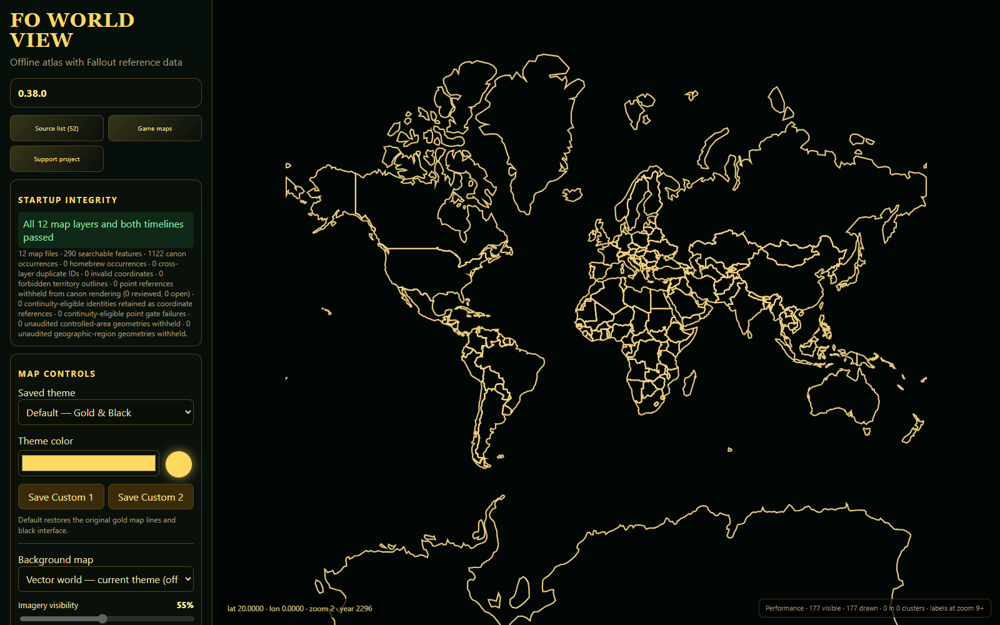
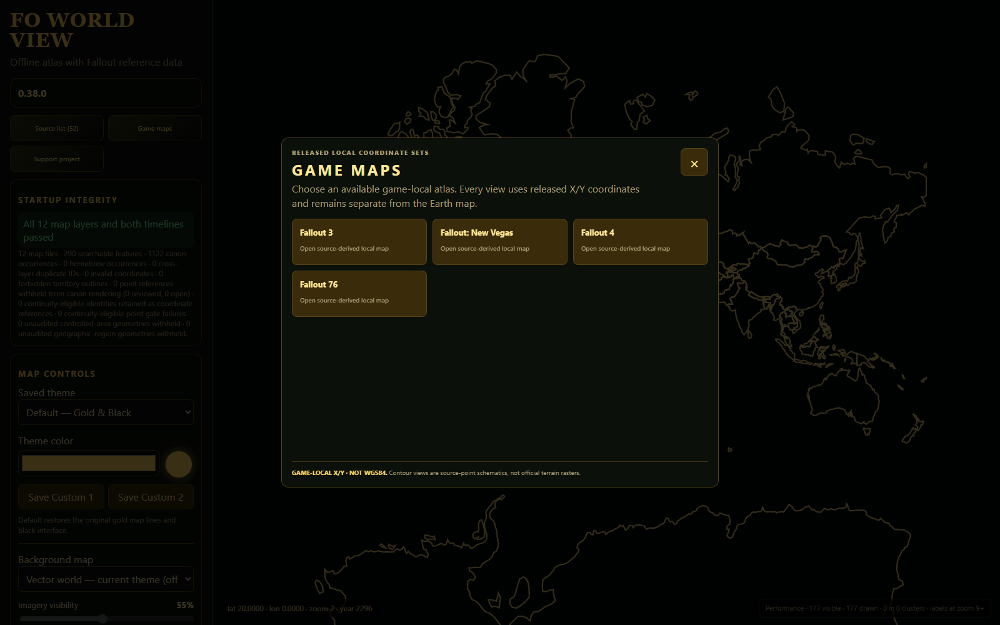
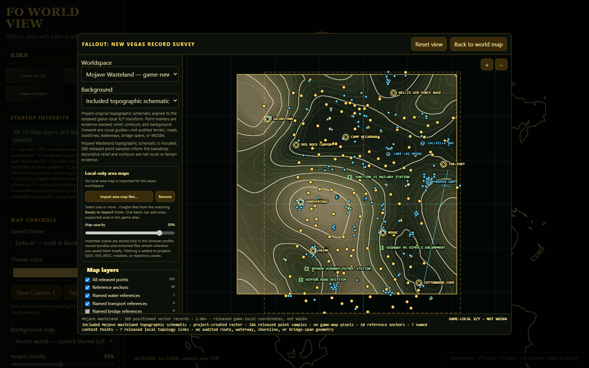

# FO World View

FO World View is a free, offline-first Windows research and campaign atlas with
independent, fan-made reference data about the Fallout games.

[Download FO World View 0.38.0](https://github.com/GreyGollum/FO-World-View-Releases/releases/tag/v0.38.0)

The recommended installer is the `Setup.exe` inside the release ZIP. An MSI is
also included for people who specifically need Windows Installer deployment.
The installers are currently unsigned, so Windows may show an unknown-publisher
warning.

## Highlights

- Offline world atlas with optional bundled regional USGS imagery.
- Searchable sources grouped by official canon, other official material,
  reference material, and homebrew.
- Separate game-local X/Y views for Fallout 3, Fallout: New Vegas, Fallout 4,
  and Fallout 76; game-local coordinates are never presented as latitude and
  longitude.
- Eighteen project-original topographic schematics for supported Fallout 3 and
  New Vegas areas. They contain no copied or extracted game-map pixels.
- Named homebrew campaigns, allowing different timelines and event sequences
  to be saved independently.
- Optional local map creation from a user's own supported installation. Local
  outputs remain on that user's device and are not included in public packages.
- No analytics and no embedded payment widget.

## Screenshots







## Download and verification

Download the ZIP and its matching `.sha256` file from the
[v0.38.0 release](https://github.com/GreyGollum/FO-World-View-Releases/releases/tag/v0.38.0).
In PowerShell, run this command from the download folder:

```powershell
Get-FileHash .\FOworld-view-0.38.0-Windows-x64.zip -Algorithm SHA256
```

The reported hash must match the value in
`FOworld-view-0.38.0-Windows-x64.zip.sha256`. Do not run a copy whose hash does
not match.

## Support

Optional support is available through
[ko-fi.com/greygollum76](https://ko-fi.com/greygollum76). Support is voluntary
and does not unlock downloads, proprietary game assets, extracted maps, source
text, or franchise content.

## Fan-project notice

FO World View is an unofficial fan-made mapping and tabletop gaming utility. It
is not affiliated with, sponsored, approved, or endorsed by Bethesda Softworks,
ZeniMax Media, Microsoft, or Modiphius Entertainment. Fallout and related names
and marks belong to their respective owners. See [DISCLAIMER.md](DISCLAIMER.md).

This repository is only the public download and release-information home. The
application's private development source and history are not published here.
